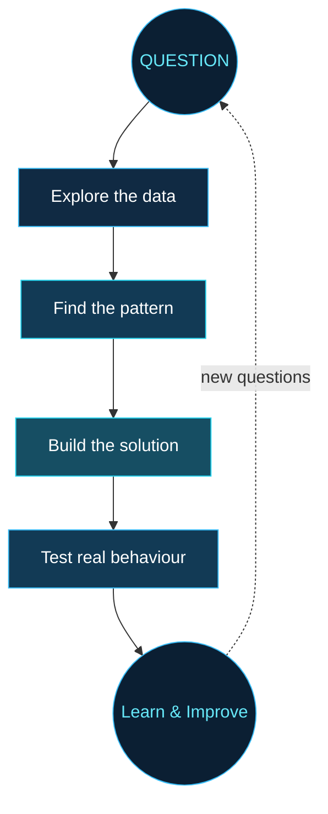

 

# DHEEKSHIKA S. ✦

### AI / DATA SCIENCE / INTELLIGENT SYSTEMS

*I turn curious questions into working experiments.*

---

### ◈ A MINDSET BUILT AROUND INTELLIGENCE

I'm a second-year B.Tech student in **Artificial Intelligence & Data Science**, exploring how algorithms, data, and software can work together to solve practical problems.

My interests sit at the intersection of **machine learning, computer vision, backend engineering, and open source**. I enjoy moving beyond theory: experimenting with ideas, building applications, testing edge cases, and learning from real-world codebases.

<table>
<tr>
<td align="center" width="33%">

### 👁️

**PERCEPTION**

Computer Vision

</td>
<td align="center" width="33%">

### ◉

**INTELLIGENCE**

Machine Learning

</td>
<td align="center" width="33%">

### ⌘

**IMPLEMENTATION**

Software Engineering

</td>
</tr>
</table>

---

# THE EXPERIMENT GALLERY

*Different problems. One curiosity: how can we make technology more useful?*

### 🤟 01 — SignSpeak

**Making sign-language learning more interactive.**

An AI-assisted learning and assessment platform that explores gesture analysis, assessment workflows, and learner feedback.

- MediaPipe landmark-based gesture analysis
- Assessment and feedback workflows
- React frontend with a FastAPI backend

`Python` `MediaPipe` `OpenCV` `React` `FastAPI`

[**EXPLORE PROJECT ↗**](https://github.com/springboardmentor15742s-oss/Team_2_Sign_Language_AI)

---

### 🚦 02 — SmartTrafficAI

**Exploring more intelligent movement through cities.**

An academic project focused on intelligent traffic-management concepts and emergency-vehicle prioritisation.

- Emergency mobility and traffic-control concepts
- Data-driven transportation ideas
- Software-based problem solving

`AI Concepts` `Intelligent Transportation` `Software Development`

[**EXPLORE PROJECT ↗**](https://github.com/Dheekshi-07/SmartTrafficAI)

---

### 🌧️ 03 — ATMOS

**Understanding rainfall patterns through data.**

Adaptive Targeted Monsoon Optimization System — a prototype exploring rainfall-regime classification, forecast bias correction, and weather-forecast evaluation.

- Rainfall-regime analysis
- Forecast correction workflows
- Weather verification metrics

`Machine Learning` `Weather Data` `Forecast Evaluation`

[**VISIT THE PROTOTYPE ↗**](https://deepshielders-atmos.vercel.app/)

---

### THE IDEA → THE SYSTEM

---

# OPEN-SOURCE FIELD NOTES

*Learning from the code that other people depend on.*

<table>
<tr>
<td width="50%" valign="top">

### ◈ Hiero Python SDK

Contributing an NFT identifier helper with serial-number validation and unit tests.

**Exploring:** input boundaries, SDK behaviour, reliable APIs.

[View PR #2735 ↗](https://github.com/hiero-ledger/hiero-sdk-python/pull/2735)

</td>
<td width="50%" valign="top">

### ◈ Watchdog

Contributing a documentation example for automatic application restart and live reload.

**Exploring:** developer experience, documentation, practical workflows.

[View PR #1268 ↗](https://github.com/gorakhargosh/watchdog/pull/1268)

</td>
</tr>
</table>

These links identify my pull requests; please check each PR for its latest review and merge status.

---

# THE TOOLBOX

*Technologies I use while learning, experimenting, and building.*

<table>
<tr>
<td width="30%" valign="top">

**⌘ Languages**

</td>
<td valign="top">

</td>
</tr>
<tr>
<td valign="top">

**✳ AI & Data**

</td>
<td valign="top">

</td>
</tr>
<tr>
<td valign="top">

**◇ Web & Backend**

</td>
<td valign="top">

</td>
</tr>
<tr>
<td valign="top">

**▤ Data Storage**

</td>
<td valign="top">

</td>
</tr>
<tr>
<td valign="top">

**⚒ Workflow**

</td>
<td valign="top">

</td>
</tr>
</table>

---

# WHAT I VALUE

<table>
<tr>
<td align="center" width="25%">

**01**

Evidence

Test before claiming.

</td>
<td align="center" width="25%">

**02**

Simplicity

Prefer clear solutions.

</td>
<td align="center" width="25%">

**03**

Reliability

Respect edge cases.

</td>
<td align="center" width="25%">

**04**

Growth

Learn from feedback.

</td>
</tr>
</table>

### OUTSIDE THE EXPERIMENT

I practise problem solving, explore new technologies, and learn by contributing to projects beyond my own repositories.

---

### FIND ME IN THE DEVELOPER COMMUNITY

 

*I don't just want to understand how things work.*

**I want to discover what else they can do.**

